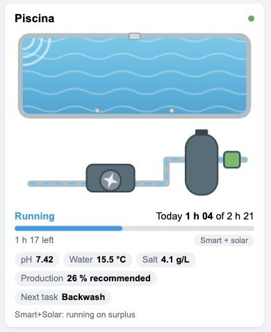

# HomePool Card

[![hacs][hacs-badge]][hacs-url]
[![release][release-badge]][release-url]
[![validate][validate-badge]][validate-url]
[![licence][licence-badge]](LICENSE)

The Lovelace card for [HomePool][integration]. It draws the pool from its own
shape and size — a kidney pool is a kidney, a long lap pool is long and thin —
with the water moving only while the pump runs, and today's filtration against
the target underneath.



*Running on solar surplus: the water ripples, the returns bubble, the impeller
turns and water flows to the filter. The green box is the salt cell, lit while
it produces.*

## Why

A number of minutes is easy to stop reading. A pool whose water moves when the
pump runs, and stands still when it does not, is read without reading: you
notice from across the room that the pump stopped at noon on a sunny day.

## Features

- **The pool, drawn from its configuration.** Square, rectangular, oval, round,
  kidney or L-shaped, in proportion; the colour of its finish; its steps, its
  skimmers and its returns.
- **Moves only while it works.** Ripples, bubbles at the returns, the impeller
  turning, water flowing through the filter. Nothing moves while the pump is
  stopped, and nothing moves at all if you have asked your system for reduced
  motion.
- **Who is running the pump**, on the chip under the bar: the mode, or what
  overrode it — a manual cycle, the maintenance lock, freeze protection,
  something switched by hand.
- **The water at a glance**: pH, temperature, salt, the recommended chlorinator
  production and the next job due.
- **One tap** opens the filtration details; the pump room opens the pump; the
  chip opens the mode.
- **Visual editor**, English and Spanish.

## Installation

### HACS (recommended)

1. HACS → three-dot menu → **Custom repositories**.
2. Add `https://github.com/domotk/homepool-card` with category **Dashboard**.
3. Install **HomePool Card** and reload your browser.

Needs the [HomePool integration][integration] 0.1.0 or newer: the card reads the
pool's shape and the ids of its entities from it.

### Manual

1. Copy `dist/homepool-card.js` into `config/www/`.
2. Settings → Dashboards → three-dot menu → **Resources** → add
   `/local/homepool-card.js` as **JavaScript module**.

## Usage

```yaml
type: custom:homepool-card
entity: sensor.pool_daily_filtration_target
```

### Options

| Option | Type | Default | Description |
|---|---|---|---|
| `entity` | string | **required** | The pool's **Daily filtration target** sensor. |
| `display_mode` | string | `pool_and_pump` | `pool`, `pump` (the equipment room) or `pool_and_pump`. |
| `card_size` | string | `medium` | `small` (the bar only), `medium` (one drawing and the figures) or `full` (both drawings, and the reason for the pump's state). |
| `show_name` | boolean | `true` | Hide the name when the page heading already says it. |
| `name` | string | — | Show this instead of the device's own name. |

The pump room is drawn in `full` size with `pool_and_pump`, or on its own with
`pump`.

### Interaction

| Gesture | Result |
|---|---|
| Tap the pool | The filtration target, with every factor that made it |
| Tap the equipment room | The pump |
| Tap the chip under the bar | The operation mode |

## Contributing

Issues and pull requests are welcome. The card is a single file with no
dependencies and no build step, so a plain editor is all you need.

## Built with

Every push is checked by the [HACS action](https://github.com/hacs/action).
No build step, no bundler: the card is a plain ES module, served as it is
written.

## Licence

MIT © Rubén Brieva

[integration]: https://github.com/domotk/homepool
[hacs-badge]: https://img.shields.io/badge/HACS-Custom-41BDF5.svg
[hacs-url]: https://github.com/hacs/integration
[release-badge]: https://img.shields.io/github/v/release/domotk/homepool-card
[release-url]: https://github.com/domotk/homepool-card/releases
[validate-badge]: https://github.com/domotk/homepool-card/actions/workflows/validate.yml/badge.svg
[validate-url]: https://github.com/domotk/homepool-card/actions/workflows/validate.yml
[licence-badge]: https://img.shields.io/github/license/domotk/homepool-card
